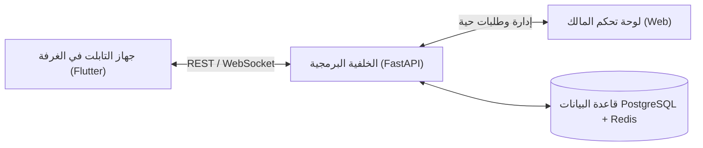

# وثيقة خطة مشروع نازل (Nazel Project Plan)

منصة الضيافة الذكية للأجهزة اللوحية داخل الغرف الفندقية والوحدات المخدومة.

---

## 1. الرؤية ونموذج العمل (Vision & Executive Summary)

> [!NOTE]
> **الهدف**: استبدال البروشورات والقوائم الورقية بكشك رقمي ذكي داخل كل غرفة (Digital Concierge Kiosk) يتيح للنزيل طلب الخدمات، تمديد الإقامة، واستكشاف الأماكن السياحية بدون الحاجة لتسجيل دخول أو تنزيل تطبيقات (Zero-friction via `deviceId`).



---

## 2. نطاق النسخة الأولى (MVP Scope & Feature Decisions)

### أ. مميزات شاشة النزيل (Tablet Kiosk)
| الخاصية | القرار | الوصف والأهمية |
| :--- | :---: | :--- |
| **الترحيب ومعلومات الحجز** | **IN MVP** | اسم النزيل، رقم الغرفة، مواعيد الدخول والخروج، والعد التنازلي للمغادرة. |
| **التبديل التلقائي للغة** | **IN MVP** | تحديد اللغة تلقائياً حسب ملف الحجز (عربي / إنجليزي/ صيني / كوري / ياباني  ) مع إمكانية التبديل اليدوي. |
| **واي فاي QR وتعليمات الوحدة** | **IN MVP** | مسح فوري للاتصال بالشبكة + دليل استخدام الأجهزة وشروط المغادرة. |
| **زر الطوارئ والدعم المباشر** | **IN MVP** | اتصال فوري (الشرطة 999، الإسعاف 997، الصيانة والاستقبال). |
| **طلب خدمات التنظيف والغسيل** | **IN MVP** | اختيار نوع الخدمة (سريع، شامل، شراشف، كوي) وتحديد الوقت المناسب. |
| **الدليل السياحي والأماكن القريبة** | **IN MVP** | قائمة معالم وتجارب مع **رمز QR ديناميكي** يفتحه النزيل بهاتفه للتنقل عبر خرائط Google. |
| **تمديد الإقامة** | **IN MVP** | عداد ديناميكي لعدد الليالي مع حساب التكلفة ورفع الطلب للإدارة. |

### ب. مميزات تطبيق جوال المالك والإدارة (Admin Mobile App - مستخرج من Figma)

#### 1. الخصائص المعتمدة في النسخة الأولى (IN MVP - العمليات الأساسية)
| الوحدة / الشاشة | الميزات والبيانات المستخرجة من التصميم | القرار |
| :--- | :--- | :---: |
| **المصادقة والأمان** | تسجيل الدخول بالجوال/البريد، التحقق عبر رمز OTP (4 أرقام)، وتأمين الجلسة. | **IN MVP** |
| **الرئيسية وسجل النشاط** | إحصائيات سريعة (الإيرادات، الإشغال، الوحدات المتاحة)، وتدفق الإشعارات المباشر. | **IN MVP** |
| **إدارة العقارات والوحدات** | إضافة وتعديل وحذف الوحدات: رفع الصور، المواصفات (غرف، حمام، مساحة، إطلالة)، الأسعار الأساسية، قائمة الخدمات المتوفرة، والتقويم. | **IN MVP** |
| **إدارة الحجوزات والضيوف** | استعراض الحجوزات (حالية، قادمة، سابقة، ملغاة)، تفاصيل الحجز الكاملة، ملف الضيف ورقم الهوية، اتصال/واتساب، وتحديث حالة الوصول والمغادرة (Check-in/Out). | **IN MVP** |
| **استقبال وتنفيذ طلبات النزلاء** | استلام طلبات التابلت اللحظية (تنظيف إضافي، مناشف/شراشف، صيانة أجهزة) وتحديث حالتها (جديد -> ينفذ -> مكتمل). | **IN MVP** |
| **الفواتير والمدفوعات الأساسية** | تفاصيل الدفع، طريقة السداد (مدى/بطاقة)، المبالغ المدفوعة والمتبقية، وحالة العملية. | **IN MVP** |
| **متابعة التراخيص والامتثال** | مؤشر الامتثال وتنبيهات مواعيد انتهاء الرخص (تأجير، بلدية، سجل تجاري، تأمين). | **IN MVP** |

#### 2. الخصائص المؤجلة للإصدار الثاني (POSTPONED to v2 - العمليات المتقدمة)
| الخاصية / الوحدة | الوصف والسبب | القرار |
| :--- | :--- | :---: |
| **التسعير الذكي (Smart Pricing AI)** | محرك توصيات تسعير الويكند والمواسم، اقتراحات الأسعار اليومية، وتعديل الأسعار بالجملة. | **POSTPONED (v2)** |
| **التكاملات والربط الخارجي** | المزامنة اللحظية مع قنوات الحجز (Airbnb, Booking.com, Gatherin, Google Calendar). | **POSTPONED (v2)** |
| **المركز المالي المتقدم والاشتراكات** | إدارة رصيد السحب البنكي (Payouts)، فواتير الاشتراك في المنصة، والتحليلات المعمقة. | **POSTPONED (v2)** |
| **المراسلات الآلية عبر WhatsApp** | إرسال رسائل الترحيب والتعليمات وروابط البوابة تلقائياً للضيوف. | **POSTPONED (v2)** |
| **محاكي الويب للكشك (Web Simulator)** | تشغيل نسخة تجريبية للكشك في المتصفح للعمل عليها دون الحاجة لربط أجهزة تابلت مادية. | **قيد الدراسة (v2)** |

---

## 3. متطلبات الإطلاق والنشر الميداني (MVP Publish Essentials)

> [!IMPORTANT]
> لضمان استقرار التطبيق داخل الغرف عند النشر الحقيقي، يجب تضمين النقاط التالية في الـ MVP:

1. **وضع الكشك (Kiosk Lock / Screen Pinning)**:
   - منع النزيل من الخروج من التطبيق، فتح المتصفح، أو تغيير إعدادات الجهاز.
2. **العمل بدون اتصال مؤقت (Offline Fallback & Cache)**:
   - تخزين محلي لبيانات الغرفة والواي فاي وأرقام الطوارئ في حال انقطاع شبكة العقار.
3. **نبض الجهاز (Device Heartbeat)**:
   - فحص دوري لحالة التابلت (متصل/غير متصل، مستوى البطارية والشاحن) يظهر للوحة المالك.
4. **تهيئة الجهاز السريعة (Device Provisioning)**:
   - ربط الجهاز بالغرفة عبر مسح رمز QR من لوحة المالك أثناء تجهيز الغرفة لأول مرة.
5. **مراقبة الأخطاء (Crash Reporting)**:
   - دمج أداة مثل Sentry لرصد الانهيارات وحلها فورياً قبل ملاحظة النزيل.

---

## 4. البنية التقنية للخلفية البرمجية (Backend Architecture)

- **البيئة واللغة**: Python 3.12+ مدار بواسطة أداة `uv`.
- **إطار العمل**: `FastAPI` (أداء عالي ومعالجة متزامنة).
- **قاعدة البيانات**: `PostgreSQL` + `SQLAlchemy 2.0` (Async) + `Alembic` لإدارة الهجرة.
- **التخزين المؤقت واللحظي**: `Redis` (Pub/Sub للإشعارات الفورية والكاش).

### أهم الواجهات البرمجية (Core Endpoints):
```
/api/v1/kiosk/
├── POST   /auth/handshake         (توثيق جهاز الغرفة عبر deviceId)
├── GET    /room-info              (بيانات الغرفة، الحجز، الواي فاي، التعليمات)
├── GET    /services               (قائمة الخدمات المتاحة والتنظيف)
├── POST   /requests               (إنشاء طلب تنظيف أو تمديد إقامة)
├── GET    /requests/active        (متابعة حالة الطلبات النشطة للغرفة)
└── GET    /places                 (المعالم القريبة + روابط خرائط Google)

/api/v1/admin/
├── POST   /auth/login             (دخول المالك والمشرفين)
├── CRUD   /properties & /units    (إدارة العقارات والوحدات)
├── CRUD   /devices                (ربط وإلغاء ربط أجهزة التابلت)
├── PUT    /content                (تعديل المحتوى والواي فاي والعروض)
└── PATCH  /requests/{id}/status   (تحديث حالة طلبات النزلاء)
```

---

## 5. مصفوفة الفحص الشامل (Testing Matrix)

```
[Unit Tests]        -> اختبار منطق الحسابات وصحة البيانات (Pydantic & Services)
[Integration Tests] -> اختبار تكامل الـ API مع قاعدة البيانات و Redis
[E2E Tests]         -> اختبار دورة حياة الطلب كاملة (من إرسال التابلت حتى استلام وتحديث المالك)
```

- **أدوات الفحص**: `pytest`, `pytest-asyncio`, `httpx`, `pytest-cov`.
- **هدف التغطية**: 85%+ للمسارات الحرجة (Authentication, Ordering, Status Flow).

---

## 6. مراحل التنفيذ الزمنية (Milestone Roadmap)

### المرحلة 1: إعداد وتجهيز الـ Backend المستقل
- [ ] تهيئة بيئة العمل بـ `uv` وتثبيت FastAPI و SQLAlchemy و Alembic.
- [ ] إعداد نماذج قاعدة البيانات (Tenants, Rooms, Devices, Services, Requests).
- [ ] بناء Endpoints الكشك والإدارة.
- [ ] كتابة حزم الفحوصات (Unit, Integration, E2E).

### المرحلة 2: ربط وتطوير تطبيق التابلت (Flutter Kiosk)
- [ ] استبدال البيانات الثابتة بالاتصال المباشر مع الـ Backend.
- [ ] تفعيل نظام التخزين المحلي (Offline Caching).
- [ ] تفعيل رموز QR التفاعلية (Google Maps + Wi-Fi).
- [ ] تطبيق وضع الكشك (Kiosk Mode Lock).

### المرحلة 3: تطبيق الإدارة ولوحة التحكم (Owner & Admin Mobile App / Dashboard)
- [ ] واجهة تسجيل الدخول والتحقق برمز OTP.
- [ ] شاشات إدارة العقارات والوحدات (إضافة، تعديل، مواصفات، أسعار).
- [ ] شاشات إدارة الحجوزات، ملفات الضيوف، وتسجيل الدخول/الخروج.
- [ ] شاشة استقبال طلبات الغرف المباشرة وتحديث حالاتها.
- [ ] شاشات متابعة الفواتير الأساسية ومؤشر الامتثال والتراخيص.

### المرحلة 4: الفحص التجريبي والإطلاق (Production Release)
- [ ] تجربة الجهاز في بيئة فندقية فعلية.
- [ ] فحص سرعة الاستجابة وتحمل الاتصالات المتزامنة.
- [ ] اعتماد النسخة للتشغيل النهائي.
