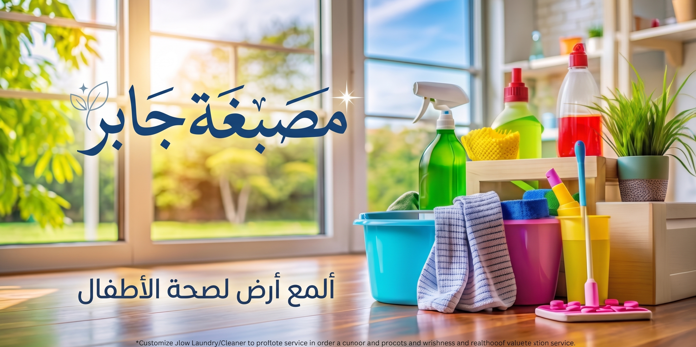
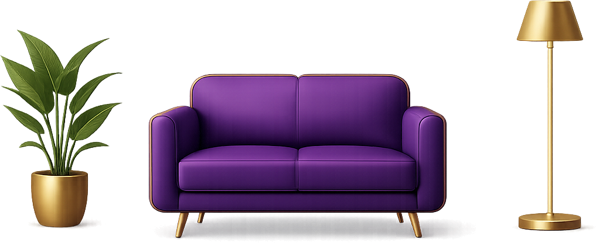

# Nazel — نازل

**منصة الضيافة والكونسيرج الذكي للأجهزة اللوحية داخل الغرف الفندقية والشقق المخدومة** 
*A modern in-room smart hospitality kiosk & digital concierge platform tailored for tablets.*

 

### المعاينة واستعراض الواجهات / Platform Showcase

<table>
 <tr>
 <td align="center"><b>لوحة الإعلانات والعروض Promotions & Ads</b></td>
 <td align="center"><b>شبكة الواي فاي للغرفة In-Room Wi-Fi & QR</b></td>
 <td align="center"><b>خدمات الضيافة والتوصيل Food & Room Service</b></td>
 <td align="center"><b>الراحة الفندقية Hospitality & Cleanliness</b></td>
 </tr>
 <tr>
 <td align="center"></td>
 <td align="center"></td>
 <td align="center"></td>
 <td align="center"></td>
 </tr>
</table>

---

## Arabic / العربية 

### منصة نازل — Nazel Hospitality Platform
**نازل (Nazel)** هو تطبيق ونظام ضيافة تفاعلي للأجهزة اللوحية (Tablets / iPads) مخصص للغرف الفندقية، والشقق المفروشة، والمنتجعات، والشاليهات الفاخرة. يعمل النظام كـ **كونسيرج رقمي (Digital Concierge Kiosk)** بديل للقوائم والبروشورات الورقية التقليدية، ويوفر للنزيل تجربة متكاملة لطلب الخدمات، استكشاف الأماكن المجاورة، حجز التجارب السياحية، والتواصل المباشر مع إدارة المنشأة.

### فلسفة التصميم وتجربة النزيل (Zero Friction)
* **استخدام فوري بدون عوائق (Zero Friction):** لا يحتاج النزيل لتحميل تطبيق أو مسح رمز أو تسجيل دخول شخصي؛ فالجهاز اللوحي مخصص لكل وحدة/غرفة ومرتبط بمعرف الغرفة (`deviceId`).
* **واجهة عريضة متكيفة (Tablet Landscape):** تصميم موجه بالكامل للأجهزة اللوحية مع مراعاة راحة العين وتوزيع العناصر بشكل متوازن.
* **دعم ثنائي اللغة أصيل (RTL / LTR):** واجهة عربية كاملة بتصميم محلي فاخر مع دعم فوري للغة الإنجليزية.
* **بيانات إقامة فورية:** عداد تنازلي لحظي يوضح الوقت المتبقي للمغادرة وتفاصيل تسجيل الوصول والخروج.
* **ربط شبكة Wi-Fi فوري:** بطاقة اتصال مدمجة برمز QR تتيح للنزيل الاتصال بشبكة الغرفة بنقرة واحدة.

### قائمة الخدمات المدمجة (Service Catalog)
* 🧹 **خدمات النظافة والغسيل:** طلب تنظيف سريع، تنظيف شامل، استبدال المناشف والشراشف، وغسيل وكي الملابس مع تحديد الوقت المفضل وإضافة الملاحظات.
* 🍔 **طلبات وتوصيل الطعام:** تصفح المطاعم، المقاهي، محلات العصائر، السوبرماركت، والصيدليات مع إضافة الوجبات للسلة وتحديد كمياتها وملاحظات النزيل.
* 📍 **المرافق القريبة:** دليل رقمي تفاعلي للمستشفيات، المساجد، محطات الحافلات، والبقالات مع حساب المسافات وتقدير وقت الوصول.
* ⛵ **السياحة والتجارب المحلية:** حجز الجولات الميدانية، رحلات اليخوت، السفاري الصحراوية والفعاليات الثقافية.
* ⏳ **تمديد الإقامة:** حاسبة ديناميكية للأيام الإضافية تحسب السعر الإجمالي وترسل طلب التمديد فوراً للإدارة.
* ℹ️ **دليل الشقة والمرافق:** أدلة تشغيل الأجهزة الذكية (التكييف، الغسالة، الشاشة الذكية) وقواعد استخدام المرافق وسياسة المغادرة.
* 🚨 **الاتصال السريع بالطوارئ:** أزرار اتصال بنقرة واحدة لأرقام الطوارئ (الشرطة 999، الإسعاف 997، الصيانة الفندقية 24/7).

### التقنيات المستخدمة (Tech Stack)
* **Framework:** [Flutter](https://flutter.dev) (Dart SDK ^3.10.x)
* **UI/UX Architecture:** Custom Design System (Atoms, Molecules, Organisms)
* **Responsive Scaling:** [flutter_screenutil](https://pub.dev/packages/flutter_screenutil)
* **Typography & Styling:** [google_fonts](https://pub.dev/packages/google_fonts) (Almarai, Tajawal)
* **Mapping & Geo-services:** [flutter_map](https://pub.dev/packages/flutter_map), [latlong2](https://pub.dev/packages/latlong2)
* **Deployment & CI/CD:** GitHub Actions Flutter Web Pages Deployment

### تجربة العرض الحي (Live Web Demo)
يمكن تجربة معاينة الواجهات مباشرة عبر متصفح الويب من خلال الرابط:  
🌐 **[رابط المعاينة الحية على GitHub Pages](https://baselcs.github.io/nazel/)**

### الخصوصية والأمان
التطبيق مصمم داخل الغرف بدون جمع بيانات خاصة أو كلمات مرور للنزلاء، حيث تعتمد طلبات الخدمة فقط على رقم الغرفة المسجل داخل المنشأة دون الاحتفاظ بأي بيانات حساسة.

### المساهمة (Contributing)
المشروع مخصص لأغراض التطوير والمراجعة البرمجية. نرحب بالإبلاغ عن المشكلات عبر [Issues](https://github.com/BaselCS/nazel/issues) أو إرسال طلبات التحسين عبر [Pull Requests](https://github.com/BaselCS/nazel/pulls).

### الترخيص (License)
هذا المشروع مرخص تحت رخصة **مصدر متاح (Source-Available License)** فقط.  
الكود متاح للاطلاع والفحص والدراسة البرمجية والشخصية فقط.  
- **يُمنع منعاً باتاً** الاستخدام التجاري أو تشغيله كخدمة SaaS أو استخدامه في منشآت تجارية دون إذن كتابي مسبق وصريح من المالك.
- للمزيد من التفاصيل راجع ملف [LICENSE](LICENSE).

---

## English 

### Nazel Hospitality Platform
**Nazel (نازل)** is a specialized in-room smart hospitality kiosk and digital concierge platform engineered for tablets (iPads / Android tablets). Designed for hotels, serviced apartments, resorts, and chalets, Nazel replaces printed menus and outdated guest binders with an elegant, interactive touchscreen dashboard.

### Core Experience & Design Philosophy (Zero Friction)
* **Zero Friction Access:** No downloads, QR scans, or logins required. The tablet is provisioned per unit and identified securely by `deviceId`.
* **Tablet Landscape Ergonomics:** Optimized specifically for widescreen tablet displays with clean spacing and accessible touch targets.
* **Bilingual Arabic & English Support:** Full RTL/LTR layout mirroring with localized typography.
* **Stay Information at a Glance:** Live stay countdown, check-in & check-out times, and property notices.
* **Instant Wi-Fi Access:** One-tap QR code display enabling guests to scan and connect their phones immediately.

### In-Room Service Catalog
* 🧹 **Housekeeping & Laundry:** Quick cleaning, deep sanitation, linen/towel changes, and garment ironing with time slot scheduling.
* 🍔 **Food & Dining Delivery:** Browse local partner restaurants, grocery stores, cafes, and pharmacies with custom requests.
* 📍 **Nearby Amenities:** Interactive directory of hospitals, transit, supermarkets, and mosques with distance and driving time estimates.
* ⛵ **Tours & Experiences:** Curated local adventures (desert safaris, boat tours, cultural sights) with booking requests.
* ⏳ **Extend Stay:** Dynamic booking extension calculator providing real-time room rates and submission to front desk.
* ℹ️ **Property & Appliance Guide:** Step-by-step guides for smart TV, climate control, appliances, and house rules.
* 🚨 **Emergency Quick Dial:** One-touch emergency access (Police, Ambulance, and 24/7 in-house maintenance).

### Tech Stack
* **Framework:** [Flutter](https://flutter.dev) (Dart SDK ^3.10.x)
* **Architecture:** Atomic Design Tokens (`NazelColors`, `NazelDimens`, `NazelTypography`)
* **Responsive Layout:** [flutter_screenutil](https://pub.dev/packages/flutter_screenutil)
* **Typography:** [google_fonts](https://pub.dev/packages/google_fonts)
* **Maps & Location:** [flutter_map](https://pub.dev/packages/flutter_map), [latlong2](https://pub.dev/packages/latlong2)
* **CI/CD:** Automated GitHub Actions build pipeline to GitHub Pages

### Live Web Demo
Experience the interactive web preview directly in your browser:  
🌐 **[Live Demo on GitHub Pages](https://baselcs.github.io/nazel/)**

### Privacy & Security
Nazel is designed with privacy-first principles. Guest requests are tied solely to the room unit identifier without tracking personal identities or storing sensitive guest information on the device.

### Contributing
Open for technical reviews and feedback. Feel free to submit [Issues](https://github.com/BaselCS/nazel/issues) or propose improvements via [Pull Requests](https://github.com/BaselCS/nazel/pulls).

### License
This project is licensed under a **Source-Available License** only.  
The source code is provided strictly for viewing, educational evaluation, and code review purposes.  
- **Commercial use, deployment in commercial properties, SaaS hosting, and redistribution are strictly prohibited** without explicit prior written authorization.  
- For full legal terms, see the [LICENSE](LICENSE) file.
